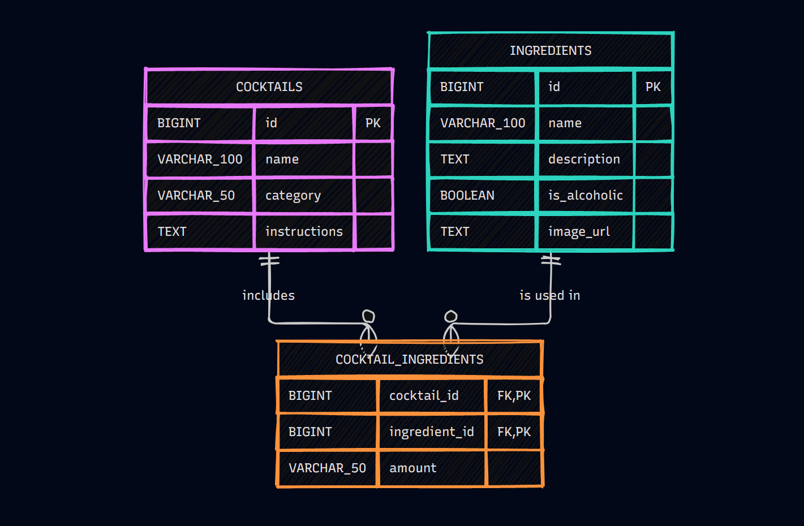

# Cocktail & Ingredient Management API

A RESTful API built with **NestJS** and **TypeScript** to manage cocktails, ingredients, and their relationships.

## Features

* Full CRUD for Cocktails & Ingredients with relational mapping.
* Input validation on request bodies.
* Pagination on listing endpoints.

## Database Model

The database is modeled in PostgreSQL running inside a Docker container.



## Getting Started

1. **Start the database in cocktails-api directory:**
   ```bash
   docker-compose up -d
   ```

2. **Install dependencies & run:**
   ```bash
   npm install
   npm run start:dev
   ```

## API Documentation

Interactive Swagger API documentation is available at `/api/docs` when the application is running (e.g., `http://localhost:3000/api/docs`).